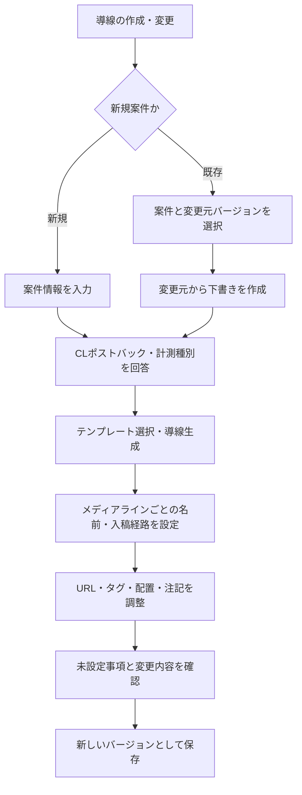
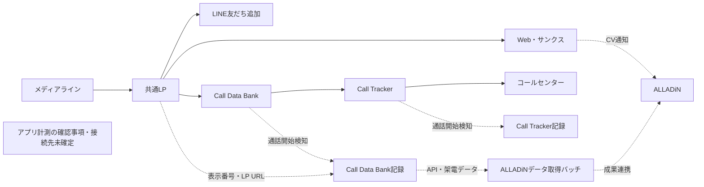

# 案件導線管理の設計

## 1. 目的と設計の状態

新規案件の広告・計測導線を整理し、既存案件の導線変更を過去の状態とともに保存する。
基本導線は質問回答から生成し、Miroのようなキャンバスで必要最低限の手動調整を行う。
概要と利用の流れは [README.md](./README.md) を参照。

本書の「確定要件」はユーザーから提示された内容、「設計案」は実装前の提案、「未決事項」は追加確認が必要な内容を指す。
初期実装を追加済み。確定要件と設計案のうち、実装した範囲は末尾の「実装状況」に記載する。

### 確定要件

- 新規案件の導線整理と、既存案件の導線変更時のバージョン保存を行う。
- 基本導線を手作業で一から描かず、必要最低限の手動変更で表現する。
- 案件作成開始時に、新規案件か、CLポストバックでCVを受け取るか、Web・アプリ・電話・LINEのどの計測が存在するかを質問する。
- 入稿経路（直メディア／ASP経由）はメディアラインごとの設定とし、案件共通の質問には含めない。同じ案件内で複数のメディアラインと異なる入稿経路を扱う。
- 計測種別ごとの図や切り替えタブを作らず、選択した計測を単一の図に収める。共通するメディアライン・LP・ALLADiNを共有し、分岐と計測情報の連携を表現する。
- LINE友だち追加とアプリ計測は別に扱う。
- 基本形は、メディアラインのAA入稿URLから `affnmsid` を介してLPへ進み、LPタグ、サンクスのCVタグ、ALLADiNのCV発生を表現する。
- ASP経由では、メディアラインのASP入稿URLからAA入稿URLへのリダイレクトを表現する。
- CLポストバックでは、CLの計測ツールでのCV発生と、ALLADiNへのポストバックによるCV発生を表現する。
- CLポストバック時、サンクスのCVタグは基本的に使用しない。ただし例外があり得るため、使用不可に固定しない。

### 初期開発の対象案

案件選択、質問フォーム、導線生成、キャンバス上の調整、下書き、バージョン保存、履歴閲覧を対象とする。
外部の広告・計測設定の変更、タグ配信、CV受信、URLへのアクセスによる実動検証は対象外とする。
画像出力、共同編集、バージョン差分の可視化、過去版からの復元は追加候補とする。

## 2. 用語と表現

| 用語                       | 本プロジェクトでの扱い                                                       |
| -------------------------- | ---------------------------------------------------------------------------- |
| 案件                       | 導線とその履歴をまとめる管理単位                                             |
| メディアライン・直メディア | 流入元。直メディアはASPを挟まない場合                                        |
| ASP入稿URL                 | ASP経由でメディアラインに設定する入口URL                                     |
| AA入稿URL                  | LPへ進む前の入口・リダイレクト経路として表現。AAの正式名称や内部仕様は未確認 |
| LP／サンクス               | ランディングページ／完了ページ                                               |
| LPタグ／CVタグ             | ページ上の計測処理。送信先や役割を別途記録する                               |
| affnmsid                   | 導線中で受け渡す識別子。発行・保持・再送の詳細な契約は別途確認する           |
| CLの計測ツール             | CL側でCVを計測する仕組み。具体的な製品・実装は案件ごとに記録する             |
| ポストバック               | 計測先から別の計測先への成果通知。画面遷移と区別する                         |
| バージョン                 | ある時点の回答、導線構造、配置、注記を保存した状態                           |

同じALLADiNでも、入口でのクリック計測と終点でのCV記録は役割が異なる。
図では役割ごとにノードを分け、同じシステムに属することを属性で表す。

## 3. 作成・変更フロー

| 案件作成時の質問               | 回答形式                          | 挙動                                                                               |
| ------------------------------ | --------------------------------- | ---------------------------------------------------------------------------------- |
| 新規案件か                     | 新規／既存                        | 既存なら案件選択。未登録の既存案件は初回登録として扱い、過去の履歴を自動生成しない |
| CLポストバックでCVを受け取るか | はい／いいえ                      | CVの記録先と通知経路を切り替える                                                   |
| 存在する計測種別               | Web／アプリ／電話／LINEの複数選択 | 選択した計測を1つの図に追加する。少なくとも1種類を選択する                         |

案件作成後は「メディアライン1」を直メディアの初期値で生成する。
メディアラインの詳細設定で名前と入稿経路を編集し、必要に応じて追加・削除する。少なくとも1つのメディアラインを保持する。
直メディアではAA入稿URLからLPへ進み、ASP経由ではASP入稿URLとAAへのリダイレクトを含める。

新規／既存は案件の登録・編集方法を決める質問であり、導線テンプレートの種類ではない。
既存版を開くと回答・手動入力・配置をそのまま読み込み、変更前に自動再生成しない。
計測種別の切り替えタブは設けない。各メディアラインの入口から共通LPへ合流し、Web・電話・LINEの経路を分岐させる。アプリの未確定事項も同じ図内に置く。

## 4. 導線生成ルール

### 4.1 メディアライン単位のWebパターン

| ID   | ASP  | CLポストバック | 生成する導線                                                                                                        |
| ---- | ---- | -------------- | ------------------------------------------------------------------------------------------------------------------- |
| W-01 | なし | なし           | メディアライン（AA入稿URL）→LP（LPタグ）→サンクス（CVタグ）→ALLADiN（CV）                                           |
| W-02 | あり | なし           | メディアライン（ASP入稿URL）→AA入稿URLへリダイレクト→LP（LPタグ）→サンクス（CVタグ）→ALLADiN（CV）                  |
| W-03 | あり | あり           | メディアライン（ASP入稿URL）→AA入稿URLへリダイレクト→LP（LPタグ）→サンクス→CL計測（CV）→ALLADiNへポストバック（CV） |
| W-04 | なし | あり           | メディアライン（AA入稿URL）→LP（LPタグ）→サンクス→CL計測（CV）→ALLADiNへポストバック（CV）                          |

W-01〜W-03はユーザーの提示例に基づく。W-04はASP有無とCLポストバック有無を独立に扱う組み合わせであり、実案件への適用は確認する。
ASP有無はメディアラインごとの `isDirect`、CLポストバック有無は案件共通の `answers.postback` で決定する。
同じ案件のWeb導線にW-01とW-02、またはW-03とW-04の入口を混在できる。1つのメディアラインの入稿経路変更で、ほかのラインや共通LP以降の手動設定を初期化しない。
いずれもAAからLPへの経路に `affnmsid` を表示する。実際の値を発行する機能は含めない。
上表は業務フローの要約であり、CVの発生はブラウザーがALLADiNの画面に遷移することを意味しない。

### 4.2 CVタグとCLポストバック

CVの受信方式とサンクスのCVタグ使用有無は別の項目として保持する。

| 項目                          | 設計案                                                         |
| ----------------------------- | -------------------------------------------------------------- |
| `cvReception`                 | `tag`／`cl_postback`。その他の方式は必要な具体例を確認後に追加 |
| `thanksCvTagUsage`            | `enabled`／`disabled`／`undecided`                             |
| 設定値の由来                  | 初期値／利用者が明示した値を区別し、再生成時の扱いを決める     |
| CLポストバックありの初期値    | `disabled`。サンクスに「CVタグなし」と表示                     |
| CLポストバックなしのWeb基本形 | `enabled`。サンクスに「CVタグ発火」と表示                      |
| タグの詳細                    | 送信先、役割、発火条件、注記。設定内容を図の属性として保存     |

初期値は新規導線の初回生成時に適用する。以後、利用者が明示した値を回答変更で黙って初期値に戻さない。
CLポストバックありでもCVタグを有効化でき、追加したタグの送信先と役割を表示する。
タグ有効・ポストバックありの併用時は、同じ成果の二重計測にならないか確認する注意を出す。併用そのものは禁止しない。
役割や送信先が未入力なら未設定として表示し、実環境での重複排除が保証されたとは扱わない。
LPタグは提示例どおり表現し、CLポストバックの選択だけで自動的に削除しない。

### 4.3 単一グラフでの計測の併存

計測種別は単一選択にせず、Web・アプリ・電話・LINEを選べる。入稿経路はメディアライン単位、CLポストバック有無と存在する計測種別は案件共通として保持する。
選択した種別を別々のキャンバスに分けず、単一のグラフに含める。Web・電話・LINEに必要な共通LPや流入経路を重複生成しない。
同じALLADiNでもクリック計測・CV記録など役割が異なる場合は、同一システム属性を持つ別ノードとして表現できる。

この図はWebの基本形と電話の参考構成を簡略化したもの。CLポストバックなどの選択でWebのCV通知経路は変わる。
電話のAPI取得やLINEの成果通知先を、案件共通のCLポストバック選択だけで確定したとは扱わない。種別ごとに異なるCV受信方式の設定が必要かは確認事項とする。

アプリ計測は具体例が未提示のため、ストア・アプリ内イベント・計測ツール・通知先やLPとの接続を推測しない。
確認事項ノードを同じグラフに置き、未確定の状態を保存する。LINEの選択や友だち追加画面をアプリ計測へ読み替えない。

### 4.4 提供資料に基づく電話・LINEの参考構成

ユーザー提供のトラッキング資料では、共通LPからメール申込・LINE・電話への分岐が描かれている。電話計測の参考構成として以下を生成する。

- LP→Call Data Bank→Call Tracker→コールセンターの電話接続。
- Call Data Bank・Call Trackerそれぞれの通話開始検知と記録。
- LPの表示番号・LP URL（`affnmsid`を含む）とCall Data Bank記録の情報連携。
- Call Data Bank記録からALLADiNデータ取得バッチへのAPI・架電データの取得と、ALLADiNへの成果連携。
- 電話計測の確認事項ノード。旧形式の電話プレースホルダーに入力された注記も引き継ぐ。

電話経路は参考構成として生成し、図全体を未確定状態として扱う。CV成立条件、電話番号の割り当て・返却、取得頻度、通知項目、使用するツールや識別子の契約を案件ごとに確認する。
実際の発信、通話開始、成果確定を同じイベントとして断定しない。

LINE選択時は、共通LPからLINE友だち追加画面への経路を生成する。成果の通知先・計測ツール・識別子が未確認なら、ALLADiNなどへ通知線を推測して接続せず、確認事項として残す。
AFADなど資料中のツール、実URL・番号・IDは全案件共通の固定値にしない。参考構成を表現できることと、その案件での実動作を保証することは分ける。

## 5. キャンバスと最小限の手動編集

### 自動化すること

- 回答に対応するノード、接続、タグ表示、識別子ラベルの生成。
- 単一キャンバスでの初期配置、共通要素への接続、計測の分岐と確認事項の配置。
- 未設定のURL・計測先・役割の表示。

### 手動操作の対象案

| 操作                                | 方針                                                         |
| ----------------------------------- | ------------------------------------------------------------ |
| ノードの移動、ズーム、パン          | 可能。移動後も接続を保つ                                     |
| URL、名称、ツール名、タグ属性、注記 | 詳細パネルで編集                                             |
| 識別子と接続ラベル                  | 専用項目で編集し、ノード名とは区別する                       |
| CVタグの使用有無・送信先・役割      | 基本値を表示し、例外を編集可能にする                         |
| 標準構造の変更                      | 案件共通の質問回答またはメディアラインの入稿経路変更で再生成 |
| 任意ノード・接続の追加／削除        | 初期開発への採否は未定。例外導線の具体例から必要な操作を絞る |

一般的なホワイトボードの全機能を再現せず、配置・属性・注記の編集を優先する。
構造上の例外を注記だけで完成扱いにせず、未対応事項として表示する。

接続は、少なくとも「遷移・リダイレクト」「計測・通知」「電話接続」の種類を持つ。
実線・破線などのスタイルと文字ラベルを併用し、凡例を表示する。色だけに意味を依存させない。
タグはページに紐づく処理、ALLADiNなどはシステム、CVはイベントとして区別して保持する。

### 再生成と手動調整の保持

1. 案件の質問回答とメディアライン設定から生成した基本構造を、手動の属性・配置調整と分けて保持する。
2. ノードには導線ID・メディアラインID・意味上の役割に基づく安定したIDを付け、表示名や配列順で照合しない。共通LP以降はメディアラインの追加・削除でIDを変えない。
3. 回答変更時は新しい構造を一時生成し、残る要素へ手動調整を引き継ぐ。
4. 消える要素への注記や、適用できなくなる調整を一覧表示する。利用者の確認前に破棄しない。
5. 適用またはキャンセルを選べるようにし、再生成結果が古い下書きからのものなら適用を拒否する。

## 6. 画面構成案

| 画面・領域         | 主な内容                                                     |
| ------------------ | ------------------------------------------------------------ |
| 案件一覧           | 案件名、最新保存版、更新日時、下書きの有無                   |
| 作成・変更フォーム | 最初の質問、案件情報、計測種別ごとの補足項目                 |
| 導線エディター     | 全計測を表示する単一キャンバス、詳細パネル、凡例、未設定一覧 |
| 保存確認           | 変更元、変更理由、未設定事項、保存操作                       |
| 履歴・過去版表示   | バージョン番号、保存日時、変更理由、保存時の導線             |

閲覧中の版、編集中の下書き、未保存の変更を識別できるようにする。
保存済み版は閲覧表示とし、編集開始時に下書きを作る。

## 7. データモデル案

| データ      | 主な項目                                                                                                     |
| ----------- | ------------------------------------------------------------------------------------------------------------ |
| `Case`      | ID、案件名、案件の登録区分、最新保存版ID、作成・更新日時                                                     |
| `Draft`     | ID、案件ID、変更元バージョンID、編集開始時の最新保存版ID、下書き改訂番号、スナップショット、変更理由         |
| `Snapshot`  | `answers`、`mediaLines`、全計測を含む単一の`graph`、データ形式版、生成ロジック版                             |
| `Answers`   | 案件共通の `postback` と `measurements`。入稿経路を含めない                                                  |
| `MediaLine` | 安定した `id`、表示用の `name`、入稿経路の `isDirect`                                                        |
| `Graph`     | `id: main`、テンプレート版、全ノード・接続、未確定状態・注記                                                 |
| `Node`      | 安定ID、役割、必要に応じたメディアラインID、表示名、所属システム、URL、タグ・イベント属性、配置              |
| `Edge`      | 安定ID、接続元・先ID、接続種別、ラベル、識別子の受け渡し属性                                                 |
| `Version`   | ID、案件ID、連番、変更元バージョンID、全設定・全導線のスナップショット、未確定事項と状態、変更理由、保存日時 |

現在のスナップショットは `schemaVersion: 3`、`generatorVersion: 3` とする。
`graph` は `id: main`、`templateVersion: 3` とし、選択した全計測のノード・接続を保持する。
`answers.measurements` の値は `web`・`app`・`phone`・`line`。LINEとアプリは別項目とする。
`mediaLines` は案件内の一覧を持ち、単一グラフの各メディアラインノードと任意のAAノードは `mediaLineId` で対応を保持する。
最初のメディアラインのIDは `default` とし、旧形式から引き継いだノードIDを維持する。

`Node` と `Edge` はグラフ内部の論理構造を示す。独立したDBテーブルにするか、構造化データとして保存するかは実装時に決める。
URL、タグ、識別子は別項目とし、図の文字列を解析して復元する方式は避ける。
`affnmsid`、ASPクリック識別子、広告最適化パラメーターを同じ識別子として扱わない。
実セッションの個人情報や実際のタグソースを集める機能は初期範囲に含めず、設計に必要な値・形式・説明を保存する。

### 旧形式との互換性

- 旧形式（データ形式版・生成ロジック版1・2）の保存版は、DB内のJSONを一切書き換えない。
- 過去版の閲覧では保存された各`route`を単一の表示グラフへ合成する。新しい生成ルールで導線を作り直さず、旧図が重ならないよう必要な表示用オフセットのみ加える。元のノード・接続・各図内の相対配置と利用者の名称を保持し、システム既定の「媒体」の呼び名だけ画面上で読み替える。
- 旧下書きの読込と旧版からの編集開始時のみ、`normalizeSnapshot` で編集用の形式3のコピーへ変換する。
- 形式1の旧 `answers.isDirect` は最初のメディアラインへ引き継ぎ、旧ノードの名称・配置・URL・注記・タグ例外を保持する。
- 旧下書きの読取だけではDBを書き換えず、利用者の下書き更新・バージョン保存で新形式を永続化する。
- 旧図単位の`route.note`は表示用グラフの`note`へ集約し、左側の「図全体の注記」から全文を閲覧できるようにする。下書きでは編集・保存でき、保存済み版では変更できない。

### バージョン保存

- 保存単位は案件全体とし、全計測を含む単一グラフを同じスナップショットに含める。
- 下書きの更新とバージョン保存を分け、ドラッグ操作のたびに履歴を増やさない。
- 明示的な保存で新しい連番を発行し、初版を含め変更理由を記録する。初版の理由には「初回作成」を使える。
- 保存済みの回答、構造、配置、注記は変更しない。後続版で変更する。
- テンプレート版、生成ロジック版、データ形式版と、実際に表示したグラフを一緒に保存する。
- 過去版の閲覧では現在のテンプレートで再生成しない。形式3は保存済みグラフを表示し、形式1・2は保存された各図を表示用に合成する。
- バージョン追加と案件の最新保存版ID更新は不可分に行う。
- 下書き作成時の最新保存版IDを保持し、保存時の現在の最新保存版IDと照合する。併せて編集対象の下書き改訂番号も照合し、競合時は黙って上書きしない。
- 競合を解決して編集を再開する場合のみ、その時点の最新保存版IDを基準として更新する。保存直前に基準を取り直して競合を見逃さない。
- 古い版から編集する場合も、分岐元と編集開始時の最新保存版を区別して保持する。最新の変更を自動統合しない。

保存日時は記録時点であり、実際の導線の切り替え日時とは限らない。稼働開始日・終了日の管理要否は未決事項とする。
保存者・編集権限は認証方式を決めた後に定義する。

## 8. システム構成案

ブラウザーで使うローカルアプリケーションとして、TypeScript・React・React Flow・Vite・Express・SQLiteを採用した。ホスティングは未選定。
以下の責務を分け、業務上の生成ルールを描画ライブラリに依存させない。

| 構成要素               | 責務                                                       |
| ---------------------- | ---------------------------------------------------------- |
| 質問フォーム           | 案件情報と回答を取得し、必要な入力を案内                   |
| テンプレート・生成処理 | 回答から型のある導線を生成。版ごとのルールを管理           |
| 配置処理               | 初期配置と接続位置を計算                                   |
| キャンバス・詳細パネル | グラフ表示、手動編集、未設定事項の表示                     |
| 検証処理               | 必須入力、接続先の存在、回答との整合性、併用時の注意を確認 |
| 保存処理・永続化       | 下書きと不変の保存版を管理し、同時更新を検知               |

初期は生成ルールを決定的なテンプレートとして実装する案とする。同じ案件回答・メディアライン設定・ルール版なら同じ意味の導線を生成する。
自動生成に外部AIを使う必要はない。
描画基盤は、ノード・接続の個別編集、初期配置、ラベル、ズーム、データ入出力、過去版の再表示ができるかを小さな試作で確認して選ぶ。

## 9. 受け入れ条件と検証計画

| ID   | 対象                 | 合格条件                                                                                                                 |
| ---- | -------------------- | ------------------------------------------------------------------------------------------------------------------------ |
| A-01 | 初回質問             | 新規／既存、CLポストバック有無、計測種別を取得し、案件共通の入稿経路を質問しない                                         |
| A-02 | 基本導線             | W-01〜W-03をノード・矢印の手作業なしで生成し、LP・CVタグ、リダイレクト、affnmsid、CV記録先を確認できる                   |
| A-03 | CVタグの初期値       | CLポストバックありならCVタグなしを初期表示。利用者が有効化すると、送信先・役割とタグ処理を図に反映できる                 |
| A-04 | 例外値の保持         | 明示的に変更したCVタグ設定が、再表示や別の回答変更で黙って初期化されない                                                 |
| A-05 | 複数計測             | Web・アプリ・電話・LINEを同時選択でき、1つの図で共通要素・分岐・未確定事項を保存・再表示できる                           |
| A-06 | 手動調整             | 位置・URL・注記を変更し、保存後も構造とともに同じ内容を読み出せる                                                        |
| A-07 | 再生成               | 各メディアラインの入稿経路などを変更しても残る要素の手動調整を保持。消える要素の調整は確認後に処理し、キャンセルもできる |
| A-08 | 履歴保存             | v1から作ったv2で回答や配置を変えても、v1の内容が変わらない                                                               |
| A-09 | 過去版再現           | テンプレート更新後も保存構造・ラベル・配置を保持。旧形式の別図合成では表示用オフセットだけを加える                       |
| A-10 | 保存競合             | 同じ下書きや最新保存版が別操作で変更された場合、古い前提の保存・再生成適用を拒否する                                     |
| A-11 | 接続・識別子         | 存在しないノードへの接続を拒否し、affnmsidと他の識別子を混同しない                                                       |
| A-12 | 電話計測             | 参考構成の電話接続・通話記録・API取得・成果連携を1つの図で識別し、未確定状態も表示する                                   |
| A-13 | メディアライン別経路 | 同じ案件で直メディアとASP経由を混在でき、1ラインの変更がほかのラインへ波及しない                                         |
| A-14 | 旧形式の互換性       | 形式1・2の保存版JSONを変更せず、旧下書き・旧版から編集して形式3の版を保存できる                                          |
| A-15 | LINEとアプリの区別   | LINEをアプリへ読み替えず、アプリの未確定経路を推測して接続しない                                                         |
| A-16 | 種別変更時の保持     | 計測種別の削除時に消える手動調整を確認し、残る共通ノードのURL・注記・配置を保持する                                      |

生成処理のテストでは、メディアラインごとのASP有無×案件のCLポストバック有無、複数ラインの混在、CVタグの明示的な例外、計測種別の組み合わせを扱う。
4種類同時選択時の共通要素の重複防止、電話接続と通知の区別、旧図の表示合成と元データ不変を確認する。
保存処理では、スナップショットの不変性、保存失敗時の部分更新防止、連番と最新保存版の競合を確認する。
画面では、配置変更、再生成の確認・キャンセル、保存版と下書きの識別、未対応種別の表示を確認する。
これらは実装時に行う検証の計画であり、現在テスト済みであることは意味しない。

共通知見の `BUG-20260910-006` を踏まえ、非同期処理では依存する下書き全体の改訂を照合する。
`BUG-20260914-013` を踏まえ、識別子は用途と受け渡しを明記する。ただし、他案件のDB結合規則を本プロジェクトの業務仕様へ転用しない。

## 10. 実装順序案

1. W-01〜W-03の質問・構造・CVタグ例外設定を、固定サンプルで確認する。
2. 生成処理とキャンバスを試作し、自動配置と最小限の編集を確認する。
3. 案件・下書き・不変のバージョン保存と履歴閲覧を実装する。
4. 再生成時の調整保持、競合検知、未設定表示を検証する。
5. 単一グラフへ電話の参考構成とLINEの分岐を加え、具体的なアプリ経路を確認して追加する。

## 11. 未決事項

| 論点                 | 次に決めること                                                                                     |
| -------------------- | -------------------------------------------------------------------------------------------------- |
| アプリ計測           | 実際の経路、計測ツール、イベント、識別子、CV通知先                                                 |
| 電話計測             | CV条件、番号管理、取得頻度・通知内容、参考構成の適用可否、ほかのパターン                           |
| LINE計測             | 成果の通知先、計測ツール、識別子、友だち追加の成立条件                                             |
| 方式の混在           | 同じ案件内で計測種別ごと・メディアラインごとに異なるCV受信方式が必要か（入稿経路の混在は対応済み） |
| CLポストバックの例外 | CVタグを併用する具体例、送信先・役割、重複計測への対応                                             |
| AA・タグ・識別子     | AAの正式な位置づけ、LPタグの送信先、affnmsidの発行・保持・受け渡し契約                             |
| 導線の規模           | 1案件内のメディアライン数・LP数・分岐数の上限と、複数LPを扱う方法                                  |
| 手動の構造変更       | 標準テンプレートで表せない例と、追加・削除を許す範囲                                               |
| 保存の運用           | 案件単位での保存の妥当性、下書きの自動保存、保存版と実稼働版の区別                                 |
| 共同利用             | 認証、閲覧・編集権限、保存者、同時編集の必要性                                                     |
| 拡張機能             | 差分表示、過去版からの復元、画像出力、共有の優先度                                                 |
| 実装基盤             | 技術構成、配置先、保存先、バックアップ、対応環境                                                   |

## 12. 判断の記録

| 日付       | 内容                                                                                       | 状態・理由                                                   |
| ---------- | ------------------------------------------------------------------------------------------ | ------------------------------------------------------------ |
| 2026-11-06 | 質問回答から基本導線を生成し、必要な手動変更を行う                                         | 確定要件。毎回描く作業を減らす                               |
| 2026-11-06 | CLポストバック時はCVタグなしを基本とし、例外を許可する                                     | ユーザー確認済み。固定すると他パターンを扱えなくなる         |
| 2026-11-06 | 回答・構造・配置・注記を不変のスナップショットとして保存                                   | 設計案。後の変更から過去版を保護する                         |
| 2026-11-06 | アプリの経路と電話の参考構成は未確定事項も保存する                                         | 設計案。検討中の履歴を残し、具体例からテンプレートを確定する |
| 2026-11-06 | 入稿経路は案件から外してメディアラインごとに設定し、画面用語を「メディアライン」に統一する | ユーザー確認済み。同一案件内で異なる入稿経路を扱う           |
| 2026-11-06 | 計測種別タブを廃止し、Web・アプリ・電話・LINEを単一グラフに収める                          | ユーザー確認済み。LINEとアプリは別に扱う                     |
| 2026-11-06 | 電話は提供資料に基づく参考構成を生成し、未確認の条件を残す                                 | 設計案。すべての案件に同じ計測仕様を強制しない               |

## 13. 実装状況（2026-11-06）

### 実装済み

- 案件一覧・検索、新規／既存案件の初回登録、案件共通の質問による導線作成。
- メディアラインの追加・名前変更・削除と、メディアラインごとの入稿経路設定。Web導線では複数の入口から共通LPへ合流する。
- W-01〜W-04のWeb導線。W-04は設計案の組み合わせも生成可能としたもので、業務上の適用可否は引き続き確認する。
- ノードのドラッグ、ズーム・パン、全体表示、URL・名称・所属・注記・タグ属性・接続ラベル・識別子の編集。
- CV受信方式とCVタグ使用有無の分離。CLポストバック時の初期値はタグなし、手動設定は再生成時も保持。
- CVタグの送信先が既存のALLADiN／CLノードに対応する場合の通知線生成。任意の送信先は属性と確認事項で表示し、実際にはない接続を推測しない。
- 構成変更のプレビュー、消える手動調整の確認、適用・キャンセル。タグ変更などで手動編集した通知線が消える場合も確認する。
- 全選択計測を表示する単一キャンバス。電話の参考構成、LINEの分岐、アプリの確認事項と未確定状態を含むバージョン保存。
- 形式3の単一グラフをSQLiteへ保存。形式1・2の保存履歴は書き換えず、表示時のみ旧図を合成し、編集開始時に新形式のコピーを作る。
- 下書き改訂番号と編集開始時の最新保存版IDの照合、トランザクションによる保存、過去版からの下書き作成。
- 「図全体の注記」の閲覧・下書きでの編集保存。旧形式の図単位メモも表示する。
- 保存履歴閲覧、案件データのJSON出力、未保存変更を伴う画面移動の確認。

### 初期実装の選択と制限

- 保存操作は明示的な「下書き保存」「バージョン保存」に分け、自動保存は行わない。
- メディアラインの追加削除を除き、接続種別・任意ノードの追加削除はテンプレートで管理する。手動では接続ラベル・識別子を編集できる。
- 入稿経路はメディアラインごとに設定する。CLポストバック有無は案件共通の回答として保持するが、電話のAPI取得やLINEの未確定通知先まで一律に確定しない。種別別・メディアライン別の詳細なCV受信方式は未実装。
- 具体的なアプリ経路、電話の参考構成以外のテンプレート、LINEの成果通知先、複数LP、画像出力、差分の可視化、JSON取り込み、認証・権限・リアルタイム共同編集は未実装。
- ローカルサーバーは `127.0.0.1` にバインドする。端末間共有・公開配置にそのまま使用する前提ではない。
- 保存者は認証導入時に追加する。現時点では作成・保存日時と変更理由を記録する。

### 実装に対応する検証

- `tests/domain.test.ts`：単一グラフの生成、共通要素、電話参考構成、LINEとアプリの区別、タグ例外、手動調整保持、削除確認、旧形式からの変換。
- `tests/server.test.ts`：API入力境界、SQLite再読込、版の不変性、競合拒否、過去版編集。
- `tests/server-compatibility.test.ts`：形式1・2の保存版JSON不変、旧下書きの読取時変換、旧版からの編集と形式3保存。
- `tests/transaction.test.ts`：保存途中の障害注入による全体ロールバックと再試行。
- `tests/e2e/workflow.spec.ts`：ブラウザー上の案件作成、タグ例外、ドラッグ、下書き保存、再生成、版保存と履歴閲覧。
